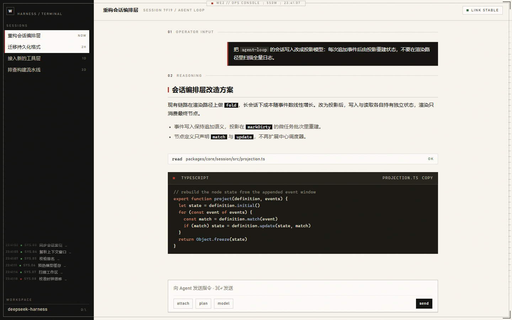
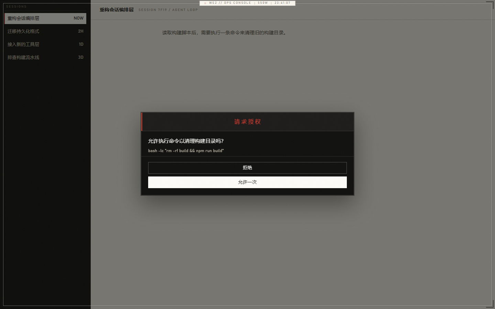

# dsh-ui-we2 · WE2 CONSOLE

[中文](README.md) | English

**An off-white / ink hard-sci-fi console skin for DeepSeek Harness.**
A web-UI reskin built on the computer-interface language of *The Wandering Earth 2*: paper panels,
an ink chassis, signal red, hairline rules, monospaced readouts. Paper conversation canvas, ink
sidebar with inverted hover, ink code decks and operator messages, zero radii, a bezel HUD, a typing
status ticker, and a centred approval dialog.

> A pure client plugin: no runtime dependencies, no network access, no build step required —
> `lib/client.js` is committed, so a clone is installable as-is.





---

## What it changes

| Layer | Effect |
|---|---|
| **Palette** | Rewrites the `--dsw-*` semantic tokens into a paper / ink pair: paper `#fdfcf8`, canvas `#f8f5ed`, ink `#111110`, signal red `#b2352a`, data cyan `#2b6771`. Both light and dark system themes resolve to the same paper palette, so switching the OS theme cannot break it. |
| **Geometry** | Every radius goes to zero (`--dsw-radius-*: 0`); elevation shadows become a 1px ink stroke plus a 1px hard offset; menus turn into opaque paper sheets with the blur removed. |
| **Type** | UI text uses Bahnschrift (the DIN-style technical face shipped with Windows) plus Microsoft YaHei; code, timestamps and counters use Cascadia Mono / JetBrains Mono. |
| **Sidebar** | An ink chassis. Hovering a session, project, panel tab, search result, the new-session button or an icon button inverts the row to **paper fill with ink text**; the selected session keeps that inversion. Row actions flip back to ink-on-paper inside an inverted row. A running session leads with a **counter-rotating dual-ring indicator**: a fine dashed outer ring turning clockwise (3.6s) around a signal-red inner arc turning the other way (1.4s). |
| **Reasoning ticker** | The free space under the session list carries a live **reasoning log** mirrored from the current conversation's latest reasoning text (read through the `uiConversation` chat snapshot, not sample data). Each line starts with an `HH:MM:SS` timestamp and is typed **line by line, character by character**; the marker is **red** while the line prints and turns **green** once it finishes (or stops at a truncation). **Long lines never wrap**: printing stops at the rail width and the trailing ellipsis **keeps blinking** to signal more content. Switching sessions rebinds and restarts the log. The layer is **fully transparent and `pointer-events: none`**, so it never blocks or intercepts input; it hides itself when the list fills the space or the sidebar collapses to the icon rail, and stays quiet when there is no reasoning. |
| **Usage dialogs** | The panels opened by the "x turns x steps" pill and the context ring become **ink panels** (paper text, hard border, no blur). Rows and readings invert to paper with ink text on hover; the bottom numbers and percentages ride a monospaced, tabular, tracked-out style. At **90% context usage and above**, the progress bar, the ring and the percentage turn signal red. |
| **Menus** | Every `role=menu` / `data-menu-material` surface (the sidebar "more" menu and the rest) is forced to an **ink panel with paper labels**, independent of sidebar or dark-theme tokens. Hovering or selecting an item **wipes a paper panel in from the left** (300ms) and flips the text to ink — the same selection move the startup screen uses for its confirm button. Danger rows stay signal red and invert to paper on red. |
| **Conversation** | Operator messages become ink panels with a signal-red edge; code blocks become ink decks with a red-dot banner and a dedicated low-saturation syntax palette; inline code becomes an ink chip; headings carry a red index tick; quotes, tables and rules are hardened. |
| **Approval dialog** | The composer takeover becomes a **centred ink dialog**: a centred 16px signal-red "请求授权" title bar with a red left edge, a scrollable request body, and answers stacked vertically at the bottom (reject outlined, allow-once filled paper). It scales in from 0.82 in 280ms while the scrim fades in; no glitch or jitter is layered on top. |
| **Code backdrop** | Speeds up the new-session code wall from `dsh-hero-code-backdrop` (96s / 138s → **42s / 60s**) so it reads as a live console rather than a still image. |
| **HUD** | A fixed screen frame, corner brackets, edge rulers, a top plate (`WE2 // OPS CONSOLE · 550W · live clock`) and very faint scanlines and paper grain. Everything is `pointer-events: none`. |

The plugin is a **pure overlay**: it only writes `--dsw-*` tokens and CSS. It does not modify React
components, make requests, or touch the session log.

## Stability and version compatibility

Designed, built and verified against **DeepSeek Harness 0.2.1-rc.3 (Electron 44.7.0 / Node 24)**.
Measured results:

| Check | Result |
|---|---|
| Runtime / peer dependencies | **None** (neither section declares anything), so there is no dependency-version surface |
| Client contract | `window.__ModuleLoader__.load({ id, factory })`, `id` equals the package name, exactly one registration |
| Host half | Exports only `name` and an empty `apply`; **no imports**, so it cannot hang on a missing service |
| Injected services | None (no `inject`); DOM is mounted inside `ctx.effect` only |
| Design tokens | Verified at runtime against the local build: `--dsw-radius-panel`, `--dsw-menu-surface-fill`, `--dsw-elevation-soft`, `--dsw-specific-*`, `--dsw-alias-*`, `--shiki-*` |
| Class hooks | `sidebarCol`, `userStack` / `userRow`, `md-code-block`, `[data-code-block-banner]`, `composerSeat` / `composerStack` all exist in the local `ui-layout` / `ui-chat` / `ui-conversation` builds |
| Failure posture | Every mount is guarded: a DOM exception logs one warning and returns a no-op disposer, **never throws into the Cordis fiber** |
| Double mount | Stale nodes are cleared before mounting, so an HMR reload cannot stack layers |
| Entry failure | The mount row is optional (no `required` flag): a failed import leaves a startup warning, it does not abort boot |

The shipped bundle was exercised in headless Chromium: mount (stylesheet, HUD, clock), double mount
(still one copy), full dispose (nodes, attributes, background restored), a synthetic DOM failure
(no throw, 2 warnings), then a clean remount.

> **About the three startup crashes on 2026-10-28**: the profile `package.json` carried a UTF-8 BOM
> (`Unexpected token ''`), not the skin code. Windows PowerShell 5.1's `Set-Content -Encoding utf8`
> writes a BOM, and an early version of this installer used exactly that. The current `install.ps1`
> writes with `UTF8Encoding($false)`, backs up before writing, validates the JSON afterwards and
> asserts the absence of a BOM.

## Install

Requires DeepSeek Harness Desktop / Web (adapted to the `0.2.1-rc.3` UI structure).

### Option 1: script (recommended)

```powershell
powershell -NoProfile -ExecutionPolicy Bypass -File .\install.ps1        # desktop profile
powershell -NoProfile -ExecutionPolicy Bypass -File .\install.ps1 -Profile web
```

The script:

1. copies the package to `<DSH_HOME>/profiles/<profile>/node_modules/dsh-ui-we2`;
2. declares `dsh-ui-we2` in that profile's `package.json` (the Loader only resolves declared packages);
3. appends a marked mount block to that profile's `cordis.patch.yml`;
4. backs up both files as `.bak`, writes **BOM-less UTF-8**, validates the JSON and asserts no BOM.

**Restart DeepSeek Harness** to load it (a new Loader entry is read at startup).

Uninstall:

```powershell
powershell -NoProfile -ExecutionPolicy Bypass -File .\install.ps1 -Uninstall
```

### Sharing it (GitHub)

This directory is a complete repository: no npm dependencies, no build step, and `lib/client.js`
plus the preview images are committed, so a clone is installable.

```powershell
git clone https://github.com/zgj980644897/dsh-ui-we2.git
cd dsh-ui-we2
powershell -NoProfile -ExecutionPolicy Bypass -File .\install.ps1
```

Or use **Code → Download ZIP** on
[github.com/zgj980644897/dsh-ui-we2](https://github.com/zgj980644897/dsh-ui-we2) and run `install.ps1`
after extracting.

- The installer is Windows-only (PowerShell). macOS / Linux users should follow **Option 2: manual**
  and point `link:` at the absolute path on their machine; the result is identical.
- The plugin is not published to npm, so `dsh plugin add dsh-ui-we2` cannot install it by name — use a path.
- After `git pull`, run `install.ps1` again (it re-copies `lib/client.js` into the profile), then restart.
- Compatibility: adapted to DeepSeek Harness `0.2.1-rc.3`. Other versions still install and uninstall;
  the `--dsw-*` token layer keeps following. If a class hook (`sidebarCol`, `sessionRow`,
  `md-code-block`, `[data-approval-key]`, …) is renamed in a future version, that one decoration falls
  back to the default style, but **startup and conversation behaviour are unaffected**.

### Update (one click)

Installed users do not need to download anything again after a release:

- **Double-click `update.cmd`** (Windows). It detects how this folder was installed —
  a `git clone` is updated with `git pull --ff-only`, a ZIP extraction downloads the
  latest source archive over this folder — then reruns `install.ps1`, prints the
  version change (for example `0.8.0 -> 0.9.0`) and asks for a restart.
- Or from a shell: `powershell -NoProfile -ExecutionPolicy Bypass -File .\update.ps1`
- Or fully manual: `git pull` (or a fresh ZIP) followed by `install.ps1`.

**Restart DeepSeek Harness** afterwards. The HUD plate shows the running version
(`550W · v0.9.0`), which is the quickest way to confirm an update landed.
### Option 2: manual

```json
// <DSH_HOME>/profiles/desktop/package.json
"dependencies": {
  "dsh-ui-we2": "link:<absolute path to this directory>"
}
```

```yaml
# end of <DSH_HOME>/profiles/desktop/cordis.patch.yml
- insert:
    - id: ui-we2
      name: dsh-ui-we2
```

Copy this directory to `<DSH_HOME>/profiles/desktop/node_modules/dsh-ui-we2`, then restart.

### Option 3: install as a bundle

`package.json` declares `dsh.bundle.patch → ./cordis.patch.yml`. Add the package to the profile's
`dsh.profile.bundles` and the bundle mechanism mounts it automatically (do not also write an `insert`
row, or the id will be duplicated).

## Plugin market / index source

- **Self-hosted index**: `https://raw.githubusercontent.com/zgj980644897/dsh-ui-we2/main/market/index.json`
  Open **Plugins → Experimental plugins → Custom plugin market** in DSH, then **Discover → Add index source**
  and paste that URL to browse and install this skin (format 1, validated with the official validator).
- A listing request has been submitted to the community market [dshopen.org](https://dshopen.org/zh/)
  (`polang233/dsh-plugin-index`); once accepted it can also be installed from that index.
## Development

```powershell
node scripts/build.mjs           # src/theme.css + src/client.js  →  lib/client.js
node scripts/check.mjs           # validates the manifest, the registration contract, and the Host import-free rule
node scripts/restore-source.mjs  # reconstructs the sources from an installed artifact (disaster recovery)
```

`preview/index.html` and `preview/approval.html` are static design previews that link the same
`src/theme.css`; open them in a browser to check colours, hover inversion and the approval dialog.
`preview/shot.png` and `preview/approval.png` are their screenshots.

- `src/theme.css` — every visual rule; the only file you normally need to edit.
- `src/client.js` — browser half: mounts the stylesheet and HUD, runs the clock, measures and mounts
  the status ticker, disposes everything, contains failures.
- `index.js` — empty Host half (the Loader needs a valid entry).
- `lib/client.js` — build artifact, **do not edit by hand**.

To change the palette, edit the `--we2-paper-*` / `--we2-ink-*` / `--we2-signal` variables at the top
of `src/theme.css`, rebuild, then restart the app.

## Structure

```
dsh-ui-we2/
├─ package.json            manifest: dsh.client, bundle patch, export map (zero dependencies)
├─ index.js                empty Host plugin (no imports)
├─ cordis.patch.yml        bundle mount patch
├─ install.ps1             install / uninstall (BOM-less writes + validation)
├─ README.md               Chinese documentation
├─ README.en.md            English documentation
├─ LICENSE                 MIT
├─ .gitignore
├─ LICENSE                 MIT
├─ src/
│  ├─ theme.css            the visual system (token overrides + component details + HUD)
│  └─ client.js            browser plugin factory body (with failure containment)
├─ scripts/
│  ├─ build.mjs            zero-dependency bundler (inlines the CSS into the module-table factory)
│  ├─ check.mjs            static contract self-check
│  └─ restore-source.mjs   reconstructs sources from the installed artifact
├─ preview/
│  ├─ index.html           static design preview (conversation + hover/selected states)
│  ├─ approval.html        approval dialog preview
│  ├─ shot.png             conversation screenshot
│  └─ approval.png         approval dialog screenshot
└─ lib/client.js           build artifact (this exact file is what gets installed)
```

## Compatibility and costs

- **Selectors are anchored on `--dsw-*` tokens**, so most styling follows product updates. A few
  details target semantic class fragments and must be re-checked after a large UI change:
  `userStack`, `bubble`, `markdown`, `md-code-block`, `[data-code-block-banner]`; the sidebar hover
  rules use `panelRow` / `sessionRow` / `projectRow` / `searchResultRow` / `newSession` / `iconButton`;
  the approval dialog uses `[data-approval-key]`.
- The sidebar border and the reasoning ticker depend on the `sidebarCol` container, plus `footArea`
  (footer height) and `sessionRow` / `projectRow` / `panelRow` (lowest occupied point). When those
  hooks are absent the ticker stays hidden and the sidebar still colours through the tokens.
- Reasoning text comes from a client service, not the DOM: the session id is read from
  `[data-conversation-session]`, then the `uiConversation.binding(id).target('chat')` snapshot's
  `order` / `nodes` supply the last `kind: 'reasoning'` block of `data.blocks` and its `text`.
  All three are internal interfaces and need re-checking on a major DSH upgrade.
- Each layout pass does one `getBoundingClientRect` measurement (rAF-batched, `ResizeObserver` plus a
  capture-phase scroll listener); no timer runs while idle. A cheap 1.5s re-attach check restores the
  ticker after the sidebar is replaced.
- Typing, slide, and sync-debounce timers all live in one set and are cleared on dispose.
  With `prefers-reduced-motion: reduce` the typing and blinking animations do not start and the reel is
  filled statically.
- The approval dialog uses `[data-approval-key]` for full-screen positioning (`position: fixed`). If a
  future version wraps that panel in a `transform` / `backdrop-filter` container, positioning becomes
  relative to that container.
- The code-wall speed override (`.dsh-hcb-track`) is inert unless `dsh-hero-code-backdrop` is installed.
- The profile dependency is written as `link:<this directory>`; if you move or delete the directory,
  run `install.ps1` again to recover.
- Appearance only: session logs, model input and tool behaviour are untouched.

## License

MIT
